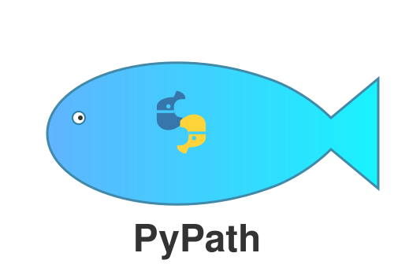

# PyPath - Python Ecopath with Ecosim

<p align="center">
  
</p>

<p align="center">
  <a href="https://www.python.org/downloads/"></a>
  <a href="https://opensource.org/licenses/MIT"></a>
  
  
  <a href="https://anaconda.org/razinka/pypath-ewe"></a>
  <a href="https://razinkele.github.io/PyPath/"></a>
</p>


### Current Version: 1.0.0

**PyPath** is a Python implementation of the Ecopath with Ecosim (EwE) ecosystem modeling framework. It extends the R package [Rpath](https://github.com/NOAA-EDAB/Rpath) with significant new features — including the first complete lifecycle Individual-Based Model for European smelt — while maintaining full core compatibility.

## Online Deployment

- **PyPath Shiny app (live):** <https://laguna.ku.lt/pypath>

## Documentation

- **API Reference & Guides:** <https://razinkele.github.io/PyPath/>
  - [Getting Started](https://razinkele.github.io/PyPath/getting-started/)
  - [Core API (Ecopath/Ecosim)](https://razinkele.github.io/PyPath/api/core/)
  - [IBM (Individual-Based Model)](https://razinkele.github.io/PyPath/api/ibm/)
  - [Spatial (Ecospace)](https://razinkele.github.io/PyPath/api/spatial/)
  - [I/O & Data Import](https://razinkele.github.io/PyPath/api/io/)
  - [Examples & Guides](https://razinkele.github.io/PyPath/examples/basic-model/)
- Historical checkpoint/process artifacts archive: [`docs/archive/root-artifacts/`](docs/archive/root-artifacts/README.md)

## Package Architecture: pypath-core vs pypath-shiny

PyPath is a monorepo with two distributable packages:

| Layer | Package name | Import | Primary role |
|---|---|---|---|
| **pypath-core** | `pypath-ewe` | `import pypath` | Scientific engine (Ecopath/Ecosim/Ecospace/IBM, IO, calibration) |
| **pypath UI** | `pypath-shiny` | `import pypath_shiny` | Interactive browser app for model setup, simulation, diagnostics, visualization, feedback |

`pypath-shiny` depends on `pypath-ewe`; `pypath-ewe` does not depend on `pypath-shiny`.

## Available Functionality

### Latest Developments (v1.0.0 line)

- **Coupled Ecosim-Ecospace workflows** with explicit state-vector utilities:
  - `pypath.spatial.build_initial_state_vector()`
  - `pypath.spatial.run_coupled_simulation()`
  - `pypath.spatial.integration.rsim_run_spatial(..., initial_state_vector=..., store_state_vectors=True)`
  - Coupled outputs include `out_Biomass_spatial`, `out_StateVector`, and `state_vector_final`
- **Scenario optimization API** for management experiments:
  - `pypath.analysis.scenario_optimizer` (`ObjectiveSpec`, `ScenarioOptimizer`, `make_spatial_management_evaluator`)
- **Expanded Ecosim functional modules**:
  - Recruitment (`pypath.core.recruitment`, `pypath.core.ecosim_recruitment`)
  - Metabolism scaling (`pypath.core.metabolism`)
  - Fishing strategy utilities (`pypath.core.fishing_management`)
  - Sensitivity/uncertainty/risk workflows (`pypath.core.sensitivity_analysis`)
- **Deterministic performance benchmark CI**:
  - Benchmark suite + regression gates + configurable thresholds
  - Guide: `packages/pypath/docs/docs/guides/performance-benchmarks.md`
- **Shiny app UX updates**:
  - Topbar version display with About and Changelog quick links
  - Feedback reporting + feedback dashboard workflow

### User Resources & Examples

- 📘 **[PyPath User Manual (PDF)](PyPath_User_Manual_v0.5.0.pdf)**
- 🌊 **[Curonian Lagoon Ecosim Example](CURONIAN_ECOSIM_README.md)**
- ⚙️ **[PEST Calibration Framework](PEST_CALIBRATION_GUIDE.md)**
- 🐠 **[Multi-Stanza Age-Structured Models](MULTISTANZA_GUIDE.md)**

### pypath-core (`pypath-ewe`)

- Ecopath mass-balance model construction and solving
- Ecosim time-dynamic simulation with forcing and scenario controls
- Ecospace spatial simulation support
- Native EwE database import/export workflows (`.eweaccdb`, `.ewecsv`)
- Calibration, diagnostics, mediation, indicators, and uncertainty workflows
- IBM (including smelt lifecycle implementation)

### pypath-shiny (`pypath-shiny`)

- Guided app workflow for data import -> Ecopath -> Ecosim -> Ecospace
- Interactive parameter editing, validation, and diagnostics
- Results plotting/tables/export for model and simulation outputs
- Advanced pages (wizard, multistanza, forcing, optimization, IBM surfaces)
- In-app **Feedback reporting + Feedback Dashboard**

## Installation

### Conda (recommended)

```bash
# Core package
conda install pypath-ewe -c razinka -c conda-forge

# With web dashboard
conda install pypath-ewe pypath-shiny -c razinka -c conda-forge
```

### From source (development)

```bash
git clone https://github.com/razinkele/PyPath.git
cd PyPath
pip install -e "packages/pypath[all]"
pip install -e "packages/pypath-shiny[dev]"
```

## Packages

| Package | Conda | Description |
|---------|-------|-------------|
| [pypath-ewe](packages/pypath/) | `conda install pypath-ewe -c razinka` | Core Ecopath/Ecosim/Ecospace + IBM algorithms |
| [pypath-shiny](packages/pypath-shiny/) | `conda install pypath-shiny -c razinka` | Interactive Shiny web dashboard |

## Highlights

### Smelt IBM: Complete Lifecycle Individual-Based Model

PyPath includes the **first complete lifecycle IBM for European smelt** (*Osmerus eperlanus*), bridging the early life stage model of Drewes et al. (2025) with a full juvenile-adult bioenergetics engine. Designed as a Baltic-applied tool for the Curonian Lagoon.

```
Egg ──── Yolk-sac ──── Feeding larva ──── Juvenile ──── Adult ──── Spawner
 │           │              │                │            │           │
 DD model    Yolk depl.     Thornton-Lessem  Ontogenetic  Wisconsin   Per-zone
 3-source    Q10 + PNR      + Type II → AF   sigmoid      bioenerg.   egg deposition
 mortality   starvation     consumption      interpolation + predation
```

**Key capabilities:**
- **Egg stage** — Degree-day development (Keller et al. 2020: DD=149 °C·day, T₀=1.8°C), thermal/oxygen/background mortality, per-zone spawning deposition
- **Yolk-sac stage** — Q10-scaled basal metabolism yolk depletion, first-feeding transition with point-of-no-return (PNR) starvation, emergent Cushing match/mismatch
- **Larval bioenergetics** — Thornton-Lessem (Fish Bioenergetics 3.0) temperature dome for Cmax, ontogenetic sigmoid interpolation (Rs+Ra metabolism, size-dependent assimilation efficiency), consumption blending from concentration-dependent Type II to adaptive foraging
- **Oxygen physiology** — Full lifecycle Pcrit-based metabolic scope reduction (4.0→2.0 mg/L egg→adult), lethal thresholds, stress-accelerated yolk depletion, behavioral O2 avoidance
- **Curonian Lagoon zonal model** — 3-zone spatial (river spawning / lagoon nursery / coastal feeding), zone-specific environmental forcing, passive drift, ontogenetic habitat constraints, spawning migration
- **Calibration framework** — ELS-aware differential evolution, Latin Hypercube Sampling sensitivity analysis, Partial Rank Correlation Coefficients (PRCC)

```python
from pypath.ibm import SmeltIBM, SmeltParams

# Enable early life stages with Baltic literature defaults
params = SmeltParams.baltic_defaults_els()

# Or with zonal spatial model
params = SmeltParams.baltic_defaults_zonal()

# Create and initialize IBM
ibm = SmeltIBM(group_index=2, n_groups=6, params=params)
ibm.initialize_from_ecosim(biomass=1.0, params={})

# Run coupled with Ecosim via apply_ibm_to_derivative()
```

**References:**
- Drewes et al. (2025) *Ecological Modelling* 510:111313
- Keller et al. (2020) *J Fish Biol* 97(2):368-381

---

### Core Ecosystem Modeling

- **Ecopath**: Mass-balance food web modeling with multi-stanza support
- **Ecosim**: Dynamic simulation with foraging arena theory (RK4 + Adams-Bashforth)
- **Ecospace**: Spatially-explicit modeling (regular, hexagonal, irregular grids)
- **Time Series Calibration**: SS fitting against observed data (EwE standard workflow)
- **Mediation Functions**: Trophic mediation via third-party biomass
- **Monte Carlo / Pedigree**: Uncertainty analysis with Morris/Sobol sensitivity
- **Ecotracer**: Contaminant tracking through the food web
- **Fleet Dynamics / MSE**: Profit-driven effort, quota management
- **Ecological Indicators**: Ascendency, cycling index, system maturity
- **Autofix**: Automatic crash diagnostics and parameter repair

### EwE Feature Parity (audited 84-table scope)

Baseline from automated parity audit (`packages/pypath/scripts/ewe_parity_audit.py`): **31 implemented**, **53 partial**, **0 missing** across the frozen 84-table target set.

| Feature | Module | Status |
|---------|--------|--------|
| Time Series & Calibration | `core.timeseries`, `core.calibration` | Done |
| Mediation Functions | `core.mediation` | Done |
| Monte Carlo / Pedigree | `core.montecarlo`, `core.pedigree` | Done |
| Ecotracer (Contaminants) | `core.ecotracer` | Done |
| Fleet Dynamics & MSE | `core.fleet_dynamics` | Done |
| Advanced Ecospace (16 tables) | `io.ewemdb` | Done |
| Ecological Indicators | `core.indicators` | Done |
| Value Chain Economics (I/O) | `io.ewemdb` | Done |
| Taxonomy Integration | `io.ewemdb` | Done |
| **IBM Early Life Stages** | **`ibm.development`, `ibm.smelt`** | **Done** |

### Interactive Dashboard

```bash
conda install pypath-shiny -c razinka -c conda-forge
pypath-shiny
```

11 professional themes, multi-file data import, real-time validation, interactive parameter editing, results visualization and export.

## Quick Start

### Basic Ecopath/Ecosim
```python
from pypath import create_rpath_params, rpath, rsim_scenario, rsim_run

# Create and balance a model
params = create_rpath_params(
    groups=["Phytoplankton", "Zooplankton", "Fish", "Detritus"],
    types=[1, 0, 0, 2],
)
# ... set biomass, PB, QB, diet matrix ...
model = rpath(params)

# Run 50-year dynamic simulation
scenario = rsim_scenario(model, params, years=range(1, 51))
output = rsim_run(scenario, method="AB")
```

### Loading Native EwE Databases
```python
from pypath.io.ewemdb import ecosim_scenario_from_ewemdb
from pypath import rsim_run

scenario = ecosim_scenario_from_ewemdb("model.eweaccdb", scenario=16)
output = rsim_run(scenario, method="AB")
```

### IBM-Coupled Ecosim Simulation
```python
from pypath.ibm import SmeltIBM, SmeltParams
from pypath.ibm.integration import apply_ibm_to_derivative

# Set up IBM with early life stages
params = SmeltParams.baltic_defaults_els()
ibm = SmeltIBM(group_index=2, n_groups=6, params=params)
ibm.initialize_from_ecosim(biomass=1.0, params={})

# IBM integrates via apply_ibm_to_derivative() in the Ecosim ODE loop
# Eggs develop, hatch, feed, grow, and recruit back into the food web
```

## Detailed Platform Comparison: PyPath vs Rpath vs Original EwE

| Dimension | **PyPath (this repository)** | **Rpath (NOAA-EDAB/Rpath)** | **Original EwE** |
|---|---|---|---|
| Primary implementation language | Python | R | C#/VB desktop stack |
| Primary interface | Python API + optional Shiny web UI (`pypath-shiny`) | R functions/workflows | Desktop GUI (Ecopath with Ecosim software) |
| Ecopath mass-balance | Implemented (`rpath`) | Implemented | Implemented |
| Ecosim dynamic simulation | Implemented (`rsim_scenario`, `rsim_run`) | Implemented | Implemented |
| Ecospace spatial simulation | Implemented (`pypath.spatial.*`, `rsim_run_spatial`) | Not part of baseline Rpath package | Implemented (native Ecospace module) |
| EwE native database handling (`.eweaccdb`) | Import/export workflows in `pypath.io.ewemdb` | Not the primary baseline workflow in Rpath | Native source format |
| Coupled state-vector workflows | Implemented (`CoupledStateVector`, `build_initial_state_vector`, `run_coupled_simulation`) | Not available as this workflow surface | Native runtime internals, not exposed as Python/R API |
| Individual-Based Model (IBM) integration | Implemented (`pypath.ibm.*`) with Ecosim derivative coupling | Not provided as built-in module | Not provided as built-in module in standard EwE distribution |
| Smelt full lifecycle IBM (egg to adult) | Implemented (`SmeltIBM`, development submodules) | Not available | Not available |
| Recruitment model API | Implemented (`RickerRecruitment`, `BevertonHoltRecruitment`, `MyersRecruitment`) + scenario patching | No equivalent modular API surface in package scope | Recruitment features available in native EwE workflows |
| Metabolism scaling API | Implemented (`MetabolicModel`, `TemperatureDependence`) | No equivalent modular API surface in package scope | Metabolism/consumption behavior available within EwE model logic |
| Fishing-management helper API | Implemented (`DynamicLogisticSelectivity`, `FishingOptimization`) | No equivalent modular API surface in package scope | Fishing controls available through EwE interface/settings |
| Sensitivity/uncertainty/risk API | Implemented (`SensitivityAnalyzer`, `UncertaintyPropagation`, `RiskAssessment`) | Typically external/add-on analysis in R workflows | Built-in EwE analysis tools plus plugin ecosystem |
| Time-series calibration API | Implemented (`fit_to_timeseries`) | Available in Rpath workflows (different API design) | Native EwE calibration workflow |
| Mediation functions | Implemented (`pypath.core.mediation`) | Not a dedicated baseline module | Native EwE capability |
| Ecotracer-like contaminant module | Implemented (`pypath.core.ecotracer`) | Not available in baseline package | Native EwE Ecotracer module |
| Fleet dynamics / MSE extensions | Implemented (`pypath.core.fleet_dynamics`) | Not available in baseline package | Management workflows available in EwE ecosystem |
| Automated parity governance | CI parity audit + release gate in this repository | Not part of baseline Rpath package | N/A (reference platform) |
| Web application layer | `pypath-shiny` package (Python Shiny) | No built-in web app in baseline package | Desktop-first application |
| Packaging and deployment | PyPI/Conda-style Python packaging + GitHub Actions deploys | R package distribution workflows | Desktop installer/distribution |
| Extensibility style | Python modules, dataclasses, test-driven CI | R ecosystem extensions/scripts | EwE plugins + desktop ecosystem |

**Interpretation note:** this table compares **PyPath repository scope** against the baseline public package surfaces of Rpath and EwE. Rows marked as "not available" refer to missing first-class module/workflow surfaces in the compared baseline package, not to every possible third-party extension.

## Testing

```bash
# Fast tests (excludes slow/integration)
pytest packages/pypath/tests/ -q -m "not integration and not slow" --ignore=packages/pypath/tests/scripts

# Full suite
pytest packages/pypath/tests/ -q --ignore=packages/pypath/tests/scripts

# IBM tests only (232 tests)
pytest packages/pypath/tests/test_ibm_*.py -v

# Shiny app tests
pytest packages/pypath-shiny/tests/ -q --ignore=packages/pypath-shiny/tests/ui
```

## Development Status

### Current Version: 1.0.0

All features production-ready. 1500+ tests passing, 0 failures.

**Completed:**
- [x] Core Ecopath/Ecosim (100% Rpath compatible)
- [x] Ecospace spatial modeling (Dec 2025)
- [x] Individual-Based Model (Feb 2026)
- [x] EMODnet data integration (Mar 2026)
- [x] EwE parity audit matrix + CI/release gate (Oct 2026)
- [x] Time series calibration, mediation, Monte Carlo, Ecotracer, fleet dynamics, indicators (Mar 2026)
- [x] **Smelt IBM early life stages — complete lifecycle model (Mar 2026)**

## Scientific References

### Core Methods
- Lucey, S. M., Gaichas, S. K., & Aydin, K. Y. (2020). Conducting reproducible ecosystem modeling using the open source mass balance model Rpath. *Ecological Modelling*, 427, 109057.
- Christensen, V., & Walters, C. J. (2004). Ecopath with Ecosim: Methods, capabilities and limitations. *Ecological Modelling*, 172(2), 109-139.

### IBM Early Life Stages
- Drewes, D., Schrum, C., Pein, J., Benkort, D. & Daewel, U. (2025). Environmental controls on the development of early life stages of European smelt in the Elbe estuary. *Ecological Modelling*, 510, 111313.
- Keller et al. (2020). Temperature effects on egg and larval development rate in European smelt. *Journal of Fish Biology*, 97(2), 368-381.
- Hanson, P. C., et al. (1997). Fish Bioenergetics 3.0. University of Wisconsin Sea Grant Institute.

## Citation

```bibtex
@software{pypath2024,
  title = {PyPath: Python Ecopath with Ecosim},
  author = {Razinkovas-Baziukas, A.},
  year = {2024--2026},
  url = {https://github.com/razinkele/PyPath},
  note = {Extends Rpath with IBM early life stages, Ecospace,
          time series calibration, and EwE database I/O}
}
```

## License

MIT License - see [LICENSE](LICENSE).

## Acknowledgments

- **Rpath**: [NOAA-EDAB/Rpath](https://github.com/NOAA-EDAB/Rpath) by Sean Lucey, Sarah Gaichas, and Kerim Aydin
- **EwE**: [www.ecopath.org](http://www.ecopath.org)
- **HORIZON EUROPE**: This work was supported by the HORIZON EUROPE research programme

---

<p align="center">
  <strong>PyPath - Advanced Python Ecosystem Modeling</strong><br>
  Complete lifecycle IBM for European smelt | Ecopath with Ecosim in Python
</p>

## Changelog

- Monorepo overview: [CHANGELOG.md](CHANGELOG.md)
- Core package: [packages/pypath/CHANGELOG.md](packages/pypath/CHANGELOG.md)
- Shiny package: [packages/pypath-shiny/CHANGELOG.md](packages/pypath-shiny/CHANGELOG.md)

